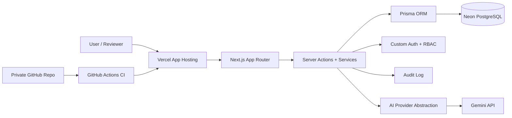

# Architecture Overview

## App Architecture

Project Fable is a Next.js App Router internal-tool MVP.

- Next.js App Router handles pages, layouts, Server Components, and Server Actions.
- Service modules under `lib/services/` hold business logic.
- Prisma manages database access.
- PostgreSQL is used on `deployment/postgres`.
- `main`/`master` remains the stable SQLite-first baseline.
- Custom auth/session code handles login, hashed session tokens, cookies, and access checks.
- RBAC separates Admin, Manager, and Member workflows.
- Audit logs record important actions.
- AI provider abstraction supports optional Gemini-backed briefing and writing workflows.

## Deployment Architecture

- GitHub private repo stores source code.
- GitHub Actions CI runs install, Prisma generate, lint, and build.
- Vercel hosts the Next.js app.
- Neon PostgreSQL stores demo/staging data.
- Vercel environment variables hold runtime secrets.
- Vercel runtime uses the Neon pooled database URL.
- Local Prisma migration work should use a direct Neon database URL when needed.

## Diagram

## Data and Privacy Notes

- No secrets are committed to the repository.
- `.env`, local database files, and generated Prisma client output are ignored.
- AI prompts use whitelisted operational data.
- AI payloads avoid password hashes, session tokens, raw audit logs, and sensitive performance-note details.
- AI output is review-only and is not automatically saved or sent.
- Audit logs should summarize actions without exposing secrets or raw sensitive data.
